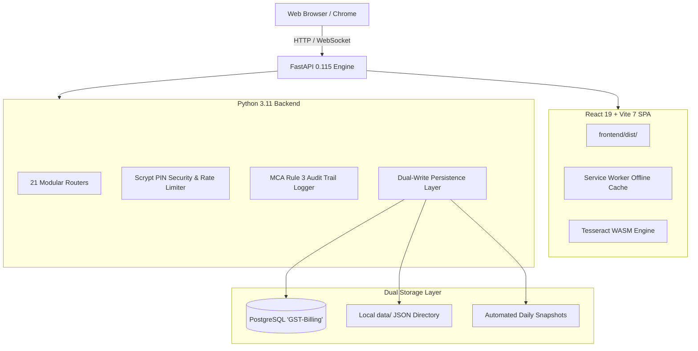

# System Architecture Specification

## Overview

The GST Billing Software is an offline-first, dual-persistence enterprise billing system built specifically for Indian businesses, SMEs, and retail counters.

---

## 1. Backend Architecture (`backend/`)
- **Framework**: FastAPI (Python 3.11 asynchronous ASGI).
- **Modularity**:
  - `backend/app/routers/`: 21 domain-specific routers matching RESTful best practices.
  - `backend/app/schemas/`: Typed Pydantic models for strict validation.
  - `backend/app/core/`: Storage, security (Scrypt), path sanitization, audit logging.
  - `backend/app/db/`: SQLAlchemy ORM models, session pool, synchronization service.
  - `backend/app/services/`: Financial year logic, recurring engine, automated daily backup rotation.

## 2. Frontend Architecture (`frontend/`)
- **Framework**: React 19 + Vite 7.
- **Offline & PWA**: Workbox service worker precaching all scripts, styles, fonts, and the 4.7MB Tesseract OCR WASM binary.
- **State Management**: Centralized store with local state slices and persistent user preferences.

## 3. Data & Storage Layer (`data/` & PostgreSQL)
- **Primary Database**: PostgreSQL (`GST-Billing`) with indexed tables:
  - `invoices`, `clients`, `products`, `expenses`, `purchases`, `cash_book`, `business_profile`, `recurring_templates`, `productions`, `audit_logs`.
- **Local Fallback Engine**: Atomic file operations (`.tmp` write + fsync + atomic rename) with in-memory TTL caching (5 seconds).
- **Statutory Audit Trail**: Permanent recording of before-and-after change diffs in accordance with MCA Rule 3(1).
